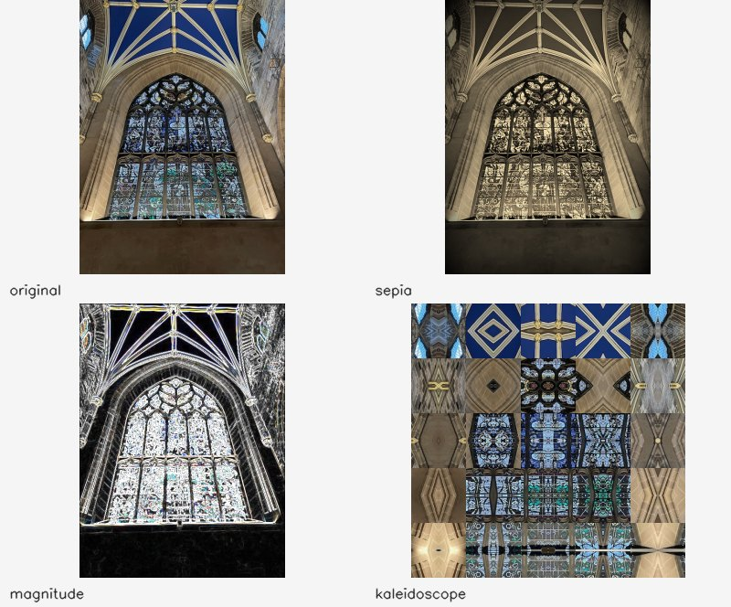
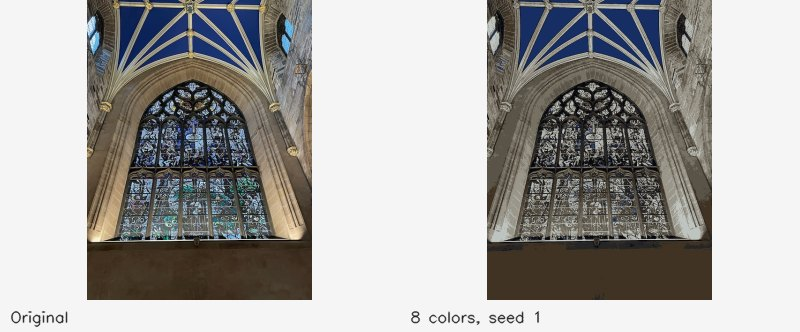
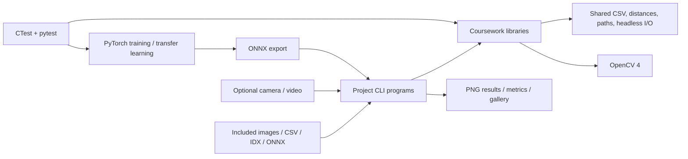

# cvCodes — computer vision, from pixels to augmented reality

[](https://github.com/Ctwqk/cvCodes/actions/workflows/ci.yml?query=branch%3Aportfolio-upgrade)

Graduate computer-vision coursework by **Taiwei Cui**: C++ image filters, content-based image retrieval, object recognition, camera calibration, AR, and CPU neural-network inference. The original CS 5330 algorithms are organised into testable libraries, runnable command-line programs, and reproducible headless demonstrations.



## Run everything

Requires Git and Docker on Linux, with at least 4 GB available for the container. The checkout contains the images, MNIST test split, trained models, and precomputed ResNet18 features; it is several hundred MB. No GPU or webcam is needed for the demonstration.

```bash
git clone --branch portfolio-upgrade https://github.com/Ctwqk/cvCodes.git
cd cvCodes
bash scripts/docker.sh bash -c 'bash scripts/verify.sh build-quickstart && python3 -m pytest project5/tests -q && bash scripts/demo.sh build-quickstart/bin results/demo'
```

The script installs Ubuntu 24.04's OpenCV 4.6 packages and pinned PyTorch 2.8.0 / torchvision 0.23.0 CPU wheels inside a disposable container, limits it to **4 GB / 4 CPUs**, builds with at most four jobs, and writes files as your host UID/GID. Package installation needs internet access and repeats on each invocation. Build products stay in `build-quickstart/`; results and the compact gallery are in `results/demo/`. It opens no windows or host ports.

On a shared production host, wrap this command in the host's global heavy-work lock and memory scope, and wait if less than 8 GB is available. The repository does not assume a particular host's lock path.

With a native C++17 compiler, CMake 3.16+, and OpenCV 4.4+ development packages:

```bash
cmake -S . -B build -DCMAKE_BUILD_TYPE=Release
cmake --build build -j4
ctest --test-dir build --output-on-failure
bash scripts/demo.sh build/bin results/demo  # also requires Python 3 + numpy + cv2
```

The commands below use `build/bin`; substitute `build-quickstart/bin` for the Docker quickstart. Run them from the repository root in the same environment as the build (Docker-built executables need the container's libraries). Every executable accepts `--help`. Data defaults resolve from the checkout used at build time; set `CVCODES_ROOT` when moving it, or supply explicit CLI paths.

## Projects

### Project 1 · image and video filters

**Problem:** transform a camera feed or photograph interactively while understanding the underlying pixel operations. **Approach:** implement separable Gaussian blur, Sobel derivatives, gradient magnitude, blur quantisation, sepia/vignette, and a mirrored kaleidoscope; reuse OpenCV for Haar-cascade face detection. The image above is produced from the included cathedral photograph.

```bash
build/bin/imgDisplay project1/cathedral.jpeg --all --max-width 600 --out results/filters
build/bin/vidDisplay --source 0                 # desktop session + webcam
```

[Project 1 guide](project1/README.md) · signed gradients and filter borders have regression tests.

### Project 2 · content-based image retrieval

**Problem:** retrieve similar photographs from the included image collection. **Approach:** compare a central patch, chromaticity/spatial histograms, Sobel texture, Gabor responses, precomputed ResNet18 embeddings, or a combined DFT/embedding descriptor using SSD, histogram intersection, or cosine distance. CSV databases keep feature extraction separate from ranking; the query image is excluded from its own results.


```bash
build/bin/establishCsv histogram --csv-dir results/cbir
build/bin/imgMatch project2/images/pic.0164.jpg histogram --csv-dir results/cbir --out results/retrieval --headless
build/bin/imgMatch project2/images/pic.0164.jpg dnn --out results/retrieval --headless
```

[Project 2 guide](project2/README.md). The supplied embedding CSV supports the included collection; this project does not extract ResNet18 features for arbitrary new photos. The gallery is a qualitative comparison, not a retrieval benchmark.

### Project 3 · segmentation and object recognition

**Problem:** identify simple objects against a relatively uniform background. **Approach:** iterative thresholding, polarity selection, morphological cleanup, connected components, oriented bounding boxes, shape descriptors, and nearest-neighbour classification. A supplied ONNX network provides an alternative region embedding. Database tools support leave-one-row-out evaluation and image holdout when recognising a training image.


```bash
build/bin/segment project3/Proj03Examples/img3P3.png --out results/segmentation --headless
build/bin/buildDb --features shape --db results/shape.csv
build/bin/evalDb --db results/shape.csv --metric scaled --k 1 --matrix
build/bin/recognize project3/trainset/ball1.jpg --db results/shape.csv --hold-out --out results/recognition --headless
```

[Project 3 guide](project3/README.md). On the 26-row collection, row-wise holdout scored **80.8% with shape features** and **69.2% with DNN features**. The small training collection is not a general object-detection benchmark. Multiple regions from one image can remain in a row-wise evaluation; see [measurement limitations](docs/RESULTS.md).

### Project 4 · calibration, pose, and augmented reality

**Problem:** place virtual geometry on a real planar target. **Approach:** detect and refine 9×6 chessboard corners, calibrate intrinsics and distortion, estimate pose with `solvePnP`, then project axes and a star. Harris corners demonstrate a separate robust-feature experiment. A seeded renderer applies perspective and radial distortion to the included checkerboard, allowing camera-free calibration against known parameters.


```bash
build/bin/synthBoard --out results/calibration --frames 20 --seed 1
build/bin/calibrate --images results/calibration --out results/intrinsics.txt --headless
build/bin/CalPos --source results/calibration/calib_0000.png --calib results/intrinsics.txt --max-frames 1 --out results/ar --headless
```

[Project 4 guide](project4/README.md). This gallery uses **synthetic camera views**, not a live-camera capture. Real cameras need their own calibration at the intended resolution.

### Project 5 · neural digit recognition and transfer learning

**Problem:** connect a trained Python model to a C++ vision application. **Approach:** two convolution/pooling stages and two fully connected layers in PyTorch, ONNX export, normalised OpenCV DNN inference, IDX data loading, and visualisation of learned convolution filters. A small Greek-letter experiment freezes the digit feature layers and trains a three-class output head.


```bash
build/bin/mnistEval --out results/mnist       # all 10,000 included test digits
build/bin/filterViz --out results/convolutions
python3 project5/greek_transfer.py --out results/greek
```

**Measured result: 98.81% (9,881/10,000)** on the included MNIST test split, using the supplied model.

[Project 5 guide](project5/README.md) · [learned filter responses](docs/gallery/convolutions.jpg). The Python tests compare shipped and newly exported ONNX outputs with the supplied PyTorch weights. Training from scratch is optional and downloads the MNIST training split.

### HW4 · colour K-means

**Problem:** approximate an image with a small colour palette. **Approach:** seeded comb sampling, iterative nearest-centroid assignments, safe handling of empty clusters, and a final assignment pass. Block sampling reduces computation; full-size reconstruction and palette shares make the result inspectable.



```bash
build/bin/colors project1/cathedral.jpeg 8 --seed 1 --out results/kmeans --headless
```

[HW4 guide](hw4/README.md). Tests cover the original division-by-zero crash when sample count is a multiple of K.

### Final project · AR snake and planar pattern tracking

**Problem:** attach a game field to a camera-observed plane. **Approach:** the original planar and 3D snake variants use chessboard pose and projected geometry. A separate SIFT descriptor database and Lucas–Kanade tracker localise image patterns with a ratio test and RANSAC homography. SIFT replaces the original nonfree SURF dependency so standard OpenCV packages suffice.


```bash
build/bin/buildPatterns --images project1 --out results/patterns.txt
build/bin/matchPatterns --patterns results/patterns.txt --source project1/cathedral.jpeg --max-frames 1 --out results/tracking --headless
build/bin/snakegame3d --source 0 --calib results/intrinsics.txt  # recalibrate for your camera first
```

[Final project guide](projectFinal/README.md). The reproducible demo renders both game fields headlessly; interactive play requires a desktop and webcam. The proposed Qt interface remains unfinished.

## Architecture and layout



| Directory | Responsibility |
| --- | --- |
| `project1` … `project5`, `hw4`, `projectFinal` | Original coursework, CLI entry points, local tests and guides |
| `common/` | Shared feature CSV format, distance metrics and input/output helpers |
| `cmake/`, `tests/`, `third_party/doctest/` | Shared C++17 build and vendored test harness |
| `scripts/` | Bounded Docker environment, full/standalone verification, headless demos, gallery curation |
| `docs/` | Small result gallery and [verification record](docs/RESULTS.md) |
| `archive/original-coursework/` | [Byte-identical historical sources and provenance manifest](archive/original-coursework/README.md), excluded from builds |

Each project also builds independently, for example:

```bash
cmake -S project2 -B build/project2
cmake --build build/project2 -j4
ctest --test-dir build/project2 --output-on-failure
```

`CVC_BUILD_TESTS=OFF` omits tests; `CVC_BUILD_PROJECTFINAL=OFF` omits the final project from the top-level build. CI builds every project, verifies all independent configurations, runs CTest and Python tests, and executes the complete headless demo. Gallery outputs and test logs are uploaded as workflow artifacts.

## Design notes and next steps

- Explicit feature vectors and simple CSVs favour inspectability over large-scale retrieval performance. These are educational implementations, not a search service.
- Headless and interactive programs share the same algorithms. The synthetic calibration renderer is a controlled test fixture; it cannot establish real-world robustness.
- The supplied models and photos are retained. Results record their actual successes and mistakes; no training run or accuracy is invented.
- Linux/OpenCV 4.6 is exercised by CI. Camera interaction, other operating systems, lighting variation, and the original proposal's Qt GUI need follow-up work.
- Original course-code attribution remains in source files. The owner still needs to choose a repository license and review redistribution permissions for course assets and pretrained models.
