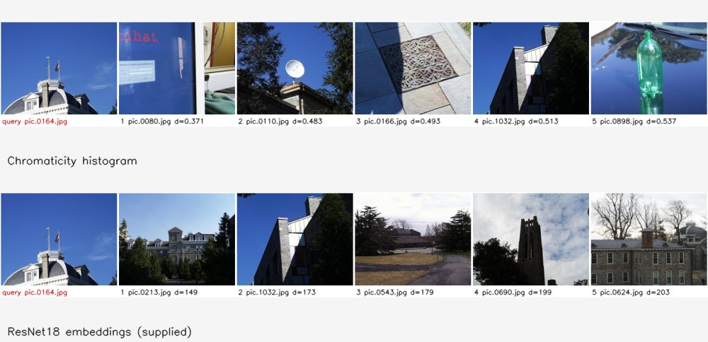

# Project 2 — content-based image retrieval

Features: central colour patch, chromaticity/spatial histograms, Sobel texture, Gabor responses, supplied ResNet18 embeddings, and combined DFT/embedding descriptors. `establishCsv` creates databases; `imgMatch` ranks them and renders a query/result montage.

```bash
build/bin/establishCsv all --csv-dir results/cbir --dnn-csv project2/featureCsvs/ResNet18_olym.csv
build/bin/imgMatch project2/images/pic.0164.jpg histogram --csv-dir results/cbir --out results/retrieval --headless
build/bin/imgMatch project2/images/pic.0164.jpg dnn --out results/retrieval --headless
```

Run from the root after [building](../README.md#run-everything). Use `--top N` for more results and `--worst` for least-similar examples. `--images DIR` accepts a different collection, but DNN-dependent features need matching precomputed rows. CSV names cannot contain commas or newlines.



Tests cover feature dimensions and normalisation, distance metrics, ranking, self-exclusion, and CSV errors. Results are qualitative; no labelled retrieval benchmark is claimed.
