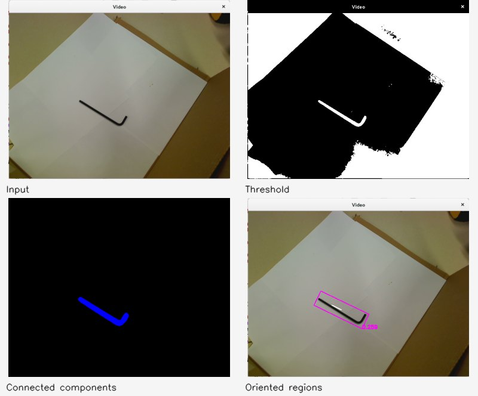

# Project 3 — segmentation and recognition

`pipeline.cpp` composes thresholding, morphology, connected components and oriented region measurements. The recognition library classifies shape features or supplied ONNX embeddings with nearest neighbours.

```bash
build/bin/segment project3/Proj03Examples/img3P3.png --out results/segmentation --headless
build/bin/buildDb --features shape --db results/shape.csv
build/bin/evalDb --db results/shape.csv --metric scaled --k 1 --matrix
build/bin/recognize project3/trainset/ball.jpg --db results/shape.csv --hold-out --out results/recognition --headless
build/bin/buildDb --features dnn --db results/dnn.csv
build/bin/evalDb --features dnn --db results/dnn.csv --metric cosine --k 1 --matrix
```

Run from the root after [building](../README.md#run-everything). `vidDis --help` describes the interactive stream. `recognize --learn LABEL` appends a labelled observation; filename prefixes provide labels when building a directory. `--channel`, `--invert`, `--min-area`, and `--no-clean` expose segmentation choices.



Unit tests exercise threshold convergence, binary morphology, border components, region geometry, distances, voting and evaluation. `evalDb` holds out one feature row, which can leave other regions from the same source photo in training; `recognize --hold-out` excludes all rows from that image. See [measured limitations](../docs/RESULTS.md).
