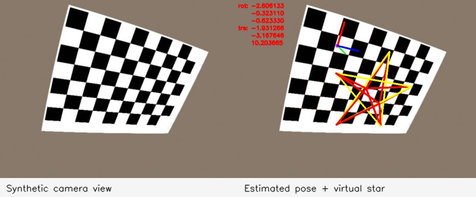

# Project 4 — camera calibration and AR

`ar_utils` contains chessboard detection, calibration, pose estimation, projection and a seeded distorted-board renderer. `CalPos` draws axes and a star; `extension` projects a texture; `RobustFeature` visualises Harris corners.

```bash
build/bin/synthBoard --out results/calibration --frames 20 --seed 1
build/bin/calibrate --images results/calibration --out results/intrinsics.txt --headless
build/bin/CalPos --source results/calibration/calib_0000.png --calib results/intrinsics.txt --max-frames 1 --out results/ar --headless
build/bin/RobustFeature --source project4/cathedral.jpeg --max-frames 1 --out results/harris --headless
```

Run from the root after [building](../README.md#run-everything). `synthBoard --mode video` produces a smooth PNG sequence accepted through `--source 'results/video/frame_%04d.png'`. The accompanying `ground_truth.txt` uses the same format as estimated intrinsics: board dimensions, a 3×3 camera matrix, then distortion coefficients.



For a real camera, run `calibrate --source 0 --out results/my-camera.txt`, use `s` to collect varied board poses, then `q` to save. Recalibrate if resolution changes. Synthetic reprojection error is a pipeline check, not measured physical-camera accuracy.
