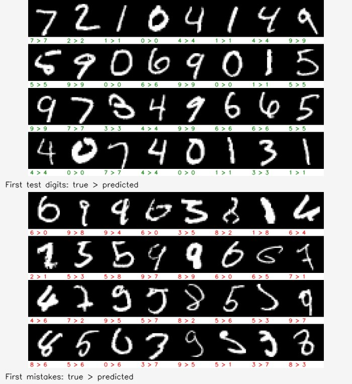

# Project 5 — PyTorch to OpenCV DNN

The supplied digit network has 1→10 and 10→20 convolution layers, pooling/dropout, and 320→50→10 fully connected layers. Both runtimes use `(pixel / 255 - 0.5) / 0.5`. The original weights, ONNX model, filter arrays, MNIST test data and small Greek-letter dataset remain included.

```bash
build/bin/mnistEval --out results/mnist
build/bin/filterViz --out results/convolutions
build/bin/mnistLive --source 0
python3 project5/predict_samples.py --out results/python-digits
python3 project5/greek_transfer.py --epochs 15 --seed 0 --out results/greek
python3 -m pytest project5/tests -q
```

Use the [Docker environment](../README.md#run-everything), or install CPU PyTorch/torchvision followed by `pip install -r project5/requirements.txt` in your own virtual environment. The optional training command `python3 project5/mnist_model.py --epochs 5 --out-dir results/training` downloads the training split; it does not overwrite the supplied model by default. `export_filters.py` downloads the first training example when regenerating arrays. C++ evaluation and the full headless demo download no models or datasets.



`mnistLive` thresholds and centres the largest digit component before classification. It is a single-digit demonstration, not OCR for arbitrary scenes. Greek transfer learning freezes the feature layers and learns a 3-class head on 27 images, with 14 test images; accuracy has high sampling uncertainty.

C++ tests cover IDX/NPY parsing, preprocessing and inference; Python tests verify weights, transforms, frozen layers, training, and OpenCV parity with both shipped and freshly exported ONNX models. Filter visualisation uses image correlation for interpretability, rather than claiming to reproduce the full normalised layer including bias and pooling.
