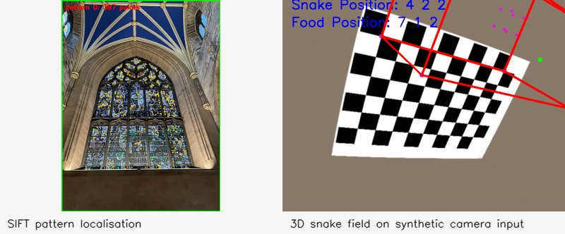

# Final project — AR snake and pattern tracking

Two original games are retained: `snakegame` constrains movement to a plane; `snakegame3d` adds vertical movement. Both attach their field to a chessboard using camera pose. Shared tools build a SIFT pattern database and track planar patterns using Lucas–Kanade flow, with reacquisition through ratio-filtered descriptor matches and RANSAC.

```bash
build/bin/buildPatterns --images project1 --out results/patterns.txt
build/bin/matchPatterns --patterns results/patterns.txt --source project1/cathedral.jpeg --max-frames 1 --out results/tracking --headless
build/bin/snakegame3d --source 0 --calib results/my-camera.txt
```

Run from the root after [building](../README.md#run-everything). Create real-camera intrinsics with Project 4 first; the old included intrinsics are only an example. `--source` accepts a camera, video or image sequence. `--headless --max-frames N --out DIR` saves overlays; `scripts/demo.sh` exercises both variants using synthetic camera views. `--width` and `--height` set game dimensions; the 3D variant also accepts `--depth`. `--offset-x` and `--offset-y` position the field in board-square units, equivalent to moving it with the keyboard before starting. The demo uses `--offset-y -5` to place the field over the board.

Controls: `w/a/s/d` move the field before starting and change direction during play; `b` starts, `c` pauses, `q` quits. In the 3D version, `<`/`>` change height or vertical direction. The pattern tracker is a separate experiment, not the game's input system.



The proposed Qt GUI was never completed. Headless rendering is verified; camera interaction and complete gameplay sessions still need manual validation. Historical presentation links are retained in the original `readme.txt` files. Pattern files now contain SIFT descriptors; rebuild any old SURF database with `buildPatterns`.
